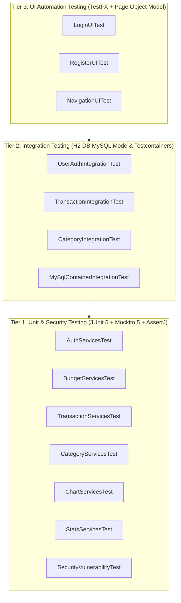

# Expense Management - SDET Test Automation Framework 📊🚀

[](https://www.oracle.com/java/)
[](https://openjfx.io/)
[](https://github.com/TestFX/TestFX)
[](https://junit.org/junit5/)
[](https://site.mockito.org/)
[](https://testcontainers.com/)
[](LICENSE)

The **Expense Management (JavaFX)** project is engineered and standardized with a comprehensive automated testing framework conforming to industry **SDET (Software Development Engineer in Test)** principles. The test framework covers the full **Test Pyramid**—from **Unit Testing**, **Integration Testing** against real/in-memory databases, to **End-to-End (E2E) UI Automation** leveraging the **Page Object Model (POM)** design pattern.

---

## 📑 Table of Contents
- [1. Test Architecture (Test Pyramid)](#1-test-architecture-test-pyramid)
- [2. SDET Design Patterns & Principles](#2-sdet-design-patterns--principles)
- [3. Project Structure](#3-project-structure)
- [4. Test Matrix](#4-test-matrix)
- [5. Setup & Test Execution Guide](#5-setup--test-execution-guide)
- [6. Technologies & Libraries](#6-technologies--libraries)

---

## 1. Test Architecture (Test Pyramid)

The testing framework is structured following standard industry Test Pyramid conventions:



- **Tier 1 - Unit & Security Testing**: Validates business logic calculations, input validation, BCrypt password hashing, and resilience against common security vulnerabilities (SQL Injection, Path Traversal, and XML/FXML Injection).
- **Tier 2 - Integration Testing**: Executes directly on real database instances (In-Memory H2 with MySQL compatibility mode and dynamically orchestrated Testcontainers MySQL 8.4). Verifies schema constraints, foreign keys, date-range filtering, and multi-tenant user data isolation.
- **Tier 3 - UI Automation Testing**: Automates end-to-end user journeys on the JavaFX desktop interface (form filling, button interactions, scene navigation, error dialog verifications) using TestFX and the Page Object Model.

---

## 2. SDET Design Patterns & Principles

### 🌟 Page Object Model (POM) for JavaFX
Decouples **test scripts** from **UI element locators and interactions**:
- `BasePage`: Encapsulates `FxRobot`, provides **Explicit Wait** synchronization mechanisms (`WaitForAsyncUtils.waitFor`), and safely handles `fire()` events on `ButtonBase` elements to prevent cursor position mismatch and lag on high-DPI (Retina) and headless display servers.
- `LoginPage`, `RegisterPage`, `TransactionsPage`: Expose business-level action APIs (`enterUsername()`, `clickLogin()`, `fillRegistrationForm()`).

### 🛡️ Test Isolation & Idempotency
- Each integration test case runs within an isolated, deterministic database state.
- Automated SQL fixture resets ([test-data.sql](ExpenseManagement/src/test/resources/test-data.sql)) execute before each test through [BaseIntegrationTest.java](ExpenseManagement/src/test/java/com/expensemanagement/integration/BaseIntegrationTest.java), eliminating **flaky tests** caused by shared state or execution order.

### 🔄 Graceful Environment Adaptation
- Seamless switching between lightweight **H2 In-Memory** (instant feedback, zero configuration) and **Testcontainers MySQL 8.4** (true containerized environment).
- Includes dynamic fallback (`@EnabledIf("isDockerAvailable")`) to skip containerized suites gracefully when running in environments without a running Docker daemon, preventing build failures.

### 🤖 Headless Testing Ready for CI/CD
- Integrated with `-Dheadless=true` or `-Dtestfx.headless=true` flags in [BaseUITest.java](ExpenseManagement/src/test/java/com/expensemanagement/ui/tests/BaseUITest.java) (configuring `glass.platform=Monocle` or virtual framebuffers via `Xvfb` on Linux runners).

---

## 3. Project Structure

```
expense-management-javaFX/
├── .gitignore
├── LICENSE
├── README.md                                # SDET Technical Documentation
└── ExpenseManagement/
    ├── pom.xml                              # Maven config: Surefire, Mockito 5, TestFX, H2, Testcontainers
    └── src/
        ├── main/
        │   ├── java/com/expensemanagement/
        │   │   ├── App.java                 # JavaFX Application EntryPoint
        │   │   ├── *Controller.java         # UI Controllers (Auth, Budget, Chart, Stats, etc.)
        │   │   ├── pojo/                    # Data Models (User, Category, Transaction, Budget, JdbcUtils)
        │   │   └── services/                # Business Service Layer (Auth, Budget, Transaction, Category)
        │   └── resources/
        │       ├── icons/                   # System visual assets
        │       └── com/expensemanagement/   # FXML Views (kebab-case) & Stylesheets
        │           ├── *.fxml               # login, register, budget, transactions, stats-table, stats-chart
        │           └── style/               # Stylesheet CSS definitions
        └── test/
            ├── resources/
            │   ├── schema.sql               # DDL Schema for test database
            │   └── test-data.sql            # Seed data fixture for Integration Tests
            └── java/com/expensemanagement/
                ├── services/                # [Tier 1] Unit & Security Tests
                │   ├── AuthServicesTest.java
                │   ├── BudgetServicesTest.java
                │   ├── CategoryServicesTest.java
                │   ├── ChartServicesTest.java
                │   ├── SecurityVulnerabilityTest.java
                │   ├── StatsServicesTest.java
                │   ├── TransactionServicesTest.java
                │   └── UserSessionServicesTest.java
                ├── integration/             # [Tier 2] Database Integration Tests
                │   ├── BaseIntegrationTest.java
                │   ├── UserAuthIntegrationTest.java
                │   ├── TransactionIntegrationTest.java
                │   ├── CategoryIntegrationTest.java
                │   └── MySqlContainerIntegrationTest.java
                └── ui/                      # [Tier 3] UI Automation Tests (POM)
                    ├── pages/
                    │   ├── BasePage.java
                    │   ├── LoginPage.java
                    │   ├── RegisterPage.java
                    │   └── TransactionsPage.java
                    └── tests/
                        ├── BaseUITest.java
                        ├── LoginUITest.java
                        ├── RegisterUITest.java
                        └── NavigationUITest.java
```

---

## 4. Test Matrix

### UI Automation Tests (`@Tag("ui")`)
| Test ID | Test Scenario | Target & Assertions |
| :--- | :--- | :--- |
| `TC-UI-01` | Initial Login Screen Rendering | Verifies visibility of Username, Password fields, Login and Register buttons |
| `TC-UI-02` | Username Input Field | Validates accurate keystroke capture in `txtUsername` |
| `TC-UI-03` | Password Input Field | Ensures password masked entry in `txtPassword` |
| `TC-UI-04` | Navigation from Login to Register | Clicks navigation button, asserts `RegisterPage` loads successfully |
| `TC-UI-05` | Initial Register Screen Rendering | Verifies First Name, Last Name, Username, Email, Password, and Confirmation fields |
| `TC-UI-06` | Complete Registration Form Submission | Automatically fills valid data into all registration fields |
| `TC-UI-07` | Navigation from Register back to Login | Clicks back button, asserts `LoginPage` reappears |
| `TC-UI-08` | Round-Trip Screen Switching | Switches back and forth between scenes to verify Stage/Scene stability |

### Integration Tests (`@Tag("integration")`)
| Test ID | Test Scenario | Target & Assertions |
| :--- | :--- | :--- |
| `IT-AUTH-01` | Register new user to database | Asserts record inserted into `user` table with BCrypt hashed password |
| `IT-AUTH-02` | Successful authentication | Matches plain password against salted hash in database |
| `IT-AUTH-03` | Authentication failure on wrong password | Returns `false` upon password mismatch |
| `IT-AUTH-04` | Authentication failure on unknown username | Returns `false` without system crash or unexpected exception |
| `IT-AUTH-05` | Duplicate Username check | Queries `user` table to verify unique constraint enforcement |
| `IT-AUTH-06` | SQL Injection defense | Submits payloads (`' OR '1'='1`, `admin'--`), confirms auth bypass prevention |
| `IT-TRAN-01` | Insert transaction into DB | Successfully persists amount, category, date, and description |
| `IT-TRAN-02` | Date-range transaction query | Filters transactions within a 5-day window, excludes out-of-range records |
| `IT-TRAN-03` | Update transaction record | Modifies amount and category, confirms DB updates correctly |
| `IT-TRAN-04` | Delete transaction from DB | Deletes by ID, asserts record no longer exists |
| `IT-CATE-01` | Fetch system default categories | Queries `category` table for records where `is_default = true` |
| `IT-CATE-02` | User Category Isolation | Asserts User B cannot access or view User A's custom categories |
| `IT-DOCKER-01`| Test on real MySQL container | Spawns MySQL 8.4 via Testcontainers and runs live verification queries |

---

## 5. Setup & Test Execution Guide

### Prerequisites
- **JDK**: Java 11, 17, or 21 LTS
- **Maven**: 3.8.0 or higher
- *(Optional)* **Docker**: Required for running containerized tests (`MySqlContainerIntegrationTest`)

### Maven Test Execution Commands

Navigate to the project root directory:
```bash
cd ExpenseManagement
```

#### 1. Run all UI Automation Tests:
```bash
mvn test -Dgroups=ui
```

#### 2. Run all Database Integration Tests:
```bash
mvn test -Dgroups=integration
```

#### 3. Run both UI & Integration Tests:
```bash
mvn test -Dgroups="ui,integration"
```

#### 4. Run UI Tests in Headless Mode (for CI/CD servers):
```bash
mvn test -Dgroups=ui -Dtestfx.headless=true
```

#### 5. Run a specific test class:
```bash
mvn test -Dtest=LoginUITest
mvn test -Dtest=UserAuthIntegrationTest
```

---

## 6. Technologies & Libraries

- **Language & Core Platform**: Java 11/17/21, OpenJFX (JavaFX 23.0.1).
- **Automation UI Framework**: TestFX (`testfx-core:4.0.18`, `testfx-junit5:4.0.18`).
- **Test Runner & Mocking**: JUnit Jupiter (`5.10.2`), Mockito (`5.11.0`).
- **Assertions**: AssertJ (`3.25.3`) Fluent Assertions.
- **Test Databases**:
  - **H2 Database** (`2.2.224`): In-memory database with MySQL Compatibility Mode.
  - **Testcontainers** (`1.19.7`): Programmatic container lifecycle for MySQL 8.4.
- **Security & Cryptography**: jBCrypt (`0.4`).
- **Build Tool**: Apache Maven with `maven-surefire-plugin` (`3.2.5`).